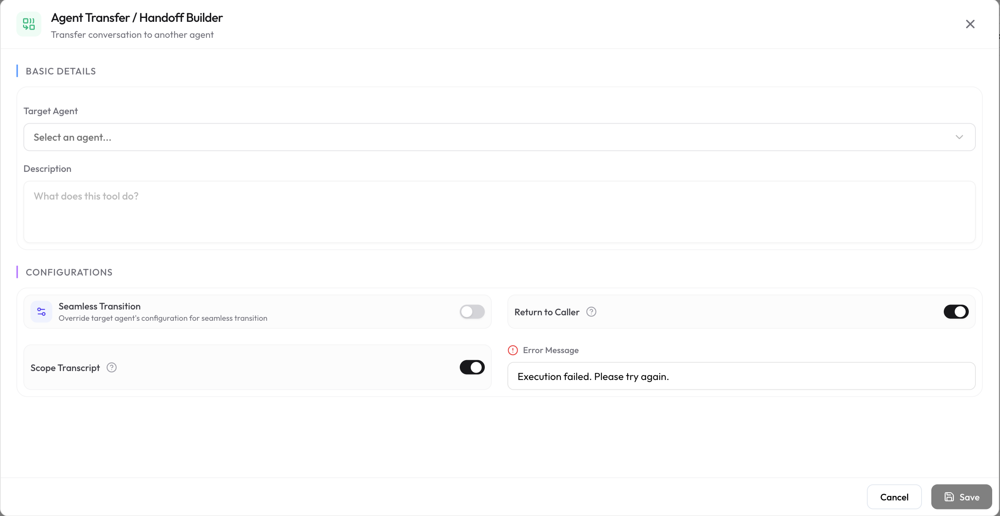

Agent Handoff lets the LLM seamlessly transfer the ongoing session to another agent on your SubVerse workspace. Use it to route customers to the right specialist — for example, escalating from a general support agent to a billing agent — without dropping the conversation.

## How It Works

When the LLM determines a handoff is needed (based on your instructions or the conversation context), it calls the handoff function. The session is transferred to the target agent, which picks up with the full conversation context passed along.

A handoff works in one of two ways:

- **Transfer**: the target agent takes over the conversation for good.
- **Delegate & Return**: the target agent handles one specific task. When the task is done, it hands the conversation back to the original agent along with the outcome, and the original agent continues from there.

## Configuring an Agent Handoff

1. Navigate to **Integrations** → **Agentic Functions** and select your agent.
2. Under **During-Session Functions**, click **+ Add Function** and choose **Agent Handoff**.
3. Select the **Target Agent** to hand off to.
4. Provide a **Description** so the LLM understands when to trigger this handoff (e.g., *"Hand off to the billing agent when the customer asks about invoices or payments"*).
5. *(Optional)* Turn on **Return to Caller** if the target agent should hand the conversation back once its task is done.
6. *(Optional, with Return to Caller)* Leave **Scope Transcript** on to keep the target agent's conversation private, or turn it off to share it.
7. Save the function.

<Tip>
  Write a clear, specific description. The LLM uses the description to decide when to call the handoff function — vague descriptions lead to incorrect or missed handoffs.
</Tip>

## Handoff Modes

| Mode | Settings | What happens | Good for |
|---|---|---|---|
| **Transfer** | Return to Caller off | The target agent takes over and keeps the conversation. | Routing the customer to a different department for the rest of the session |
| **Delegate & Return (private)** | Return to Caller on, Scope Transcript on *(default)* | The target agent finishes its task and hands back. The original agent sees only the outcome, not the target's conversation. | Self-contained steps such as identity verification or payment collection, where the details aren't needed afterwards |
| **Delegate & Return (shared)** | Return to Caller on, Scope Transcript off | Same as above, but the original agent can also see everything said during the task. | Steps where the original agent needs the full details to continue |

### When does the conversation come back?

With **Return to Caller** on, the target agent hands the conversation back when:

- the task is **completed**,
- the customer **abandons** the task, or
- the customer asks for something **outside the task**.

The original agent receives the outcome and replies to the customer right away, so the customer sees no gap.

<Tip>
  In the target agent's instructions, describe its task clearly and say when the task counts as finished. This helps it hand back at the right moment.
</Tip>

## Limitations

<Note>
  - **Return to Caller** is available for **chat** and **email agents**. Voice agents support **Transfer** for now.
  - Up to **3** Delegate & Return handoffs can be in progress at once (for example, an agent that delegates from within a delegated task).
  - Delegate & Return can't be started from a **Background Agent**.
  - Session details and post-session analysis always show the **full conversation**, even when Scope Transcript is on.
</Note>

## Availability

| Phase | Available |
|---|---|
| Pre-Session | No |
| During-Session | Yes |
| Post-Session | No |

## Next Steps

<CardGroup cols={2}>
  <Card title="Background Agent" icon="robot" href="/integrations/agentic-functions/background-agent">
    Trigger async tasks mid-conversation without blocking the LLM
  </Card>
  <Card title="Default Functions" icon="star" href="/integrations/agentic-functions/default-functions">
    Built-in platform actions available to every agent
  </Card>
</CardGroup>
