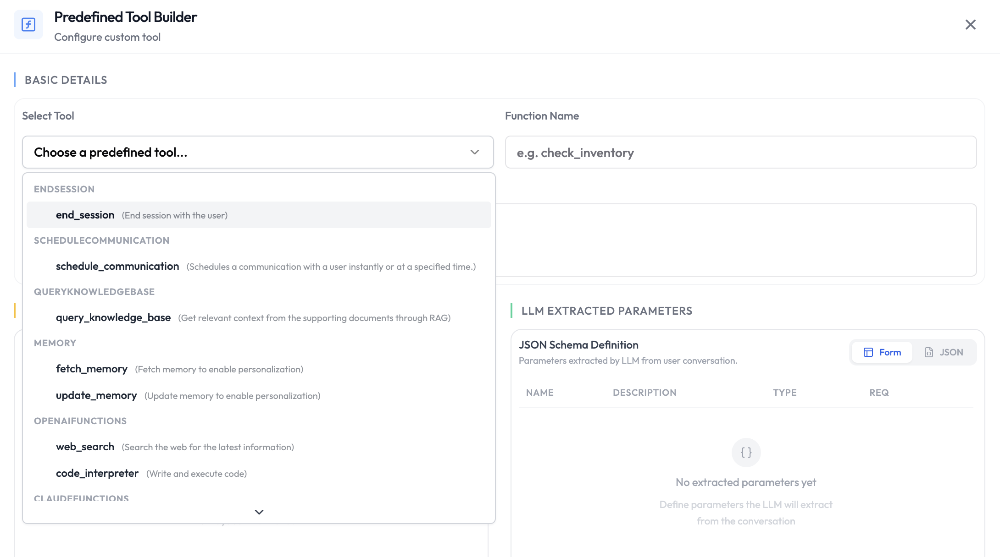

Default functions are pre-built actions provided by SubVerse AI and the underlying LLM provider. They are always available to the LLM during an active session — no webhook or custom code required. Simply enable the ones you need and instruct the agent when to use them.



## Available Default Functions

### Core Platform Functions

These functions are available regardless of which LLM you use.

| Function | Description |
|---|---|
| `end_session` | End the session when the conversation is complete. |
| `schedule_communication` | Schedule a follow-up call, message, or email for a future time. [Read more](#schedule_communication) |
| `escalate_to_human` | Hand the chat over to a human teammate. Chat agents only. [Read more](#escalate_to_human) |
| `query_knowledge_base` | Fetch relevant information from the agent's connected knowledge base. |
| `fetch_memory` | Retrieve previously stored memory for this customer or session. [Read more](#fetch_memory) |
| `update_memory` | Write new information to memory for use in future sessions. [Read more](#update_memory) |

### OpenAI LLM Functions

Available when your agent uses an OpenAI model.

| Function | Description |
|---|---|
| `web_search` | Search the web for up-to-date information. |
| `code_interpreter` | Execute Python code in a sandboxed environment for calculations, data analysis, or file generation. |

### Claude LLM Functions

Available when your agent uses an Anthropic Claude model.

| Function | Description |
|---|---|
| `web_search` | Search the web for up-to-date information. |
| `web_fetch` | Retrieve the contents of a specific URL. |
| `code_execution` | Run code in a sandboxed environment. |
| `bash` | Execute bash commands in a sandboxed environment. |

### Google Gemini LLM Functions

Available when your agent uses a Google Gemini model.

| Function | Description |
|---|---|
| `google_search` | Search Google for up-to-date information. |
| `url_context` | Retrieve and reason over the contents of a URL. |
| `google_maps` | Look up locations, directions, and place information. |
| `code_execution` | Run code in a sandboxed environment. |

## When to Use Default Functions

Default functions cover the most common actions an agent needs during a session. You do not need to create or configure them — just enable the ones relevant to your use case and instruct the agent in its system prompt when to call them.

**Common patterns:**

- End the session automatically once the user's query is resolved.
- Search the web when the agent needs real-time or external information.
- Store customer preferences in memory to personalise future sessions.
- Query the knowledge base for product details or policy documents.
- Hand the conversation to a human teammate when the customer asks for one or the agent can't resolve the issue.
- Book a follow-up call, WhatsApp message, or email when the customer asks to be contacted later.

<Tip>
  Be explicit in the agent's system prompt about when to call each function. For example: *"When the customer says goodbye or their issue is resolved, call `end_session`."* or *"Use `web_search` only when the knowledge base does not contain a definitive answer."*
</Tip>

## fetch\_memory

`fetch_memory` is a **pre-session** function that retrieves previously stored memory and injects it into the agent's context before the conversation begins. The retrieved memory is placed into a dynamic variable that you define, which you can then reference anywhere in the agent's system prompt.

### How It Works

When a session starts, `fetch_memory` looks up the memory stored under the given `memoryId` and makes it available as a dynamic variable named by `paramName`. From that point on, you can reference the memory in your system prompt using the standard double-curly-brace syntax — `{{ paramName }}`.

### Parameters

| Parameter | Type | Required | Description |
|---|---|---|---|
| `memoryId` | string | Yes | ID of the memory to retrieve. Accepts dynamic variables — use a session variable like `{{ claimId }}` or a nested tool body field like `{{ body.userDetails.id }}`. |
| `paramName` | string | Yes | Name of the dynamic variable the retrieved memory will be injected into. |

<Info>
  `memoryId` supports both top-level session variables (`{{ claimId }}`) and nested tool body paths (`{{ body.userDetails.id }}`). This makes it straightforward to scope memory to the specific customer or entity being passed in the request payload — no extra configuration needed.
</Info>

### Example

```
// Tool params
memoryId: {{ claimId }}
paramName: claimMemory

// Tool response
{
  "dynamicVariables": {
    "claimMemory": "Previous conversation memory for this claim..."
  }
}

// System prompt usage
Here is the previous claim memory which you can refer to if needed: {{ claimMemory }}
```

<Warning>
  Memory is **shared across all agents and customers in your workspace**. Always use a customer-specific `memoryId` — such as the customer's user ID or claim ID — to prevent one customer's memory from being accessible to another.
</Warning>

<Info>
  If no memory exists for the given `memoryId`, the dynamic variable returns `null`. Handle this gracefully in your system prompt — for example: *"If `{{ claimMemory }}` is empty, treat this as a new customer with no prior history."*
</Info>

---

## update\_memory

`update_memory` is a **post-session** function that extracts key information from the conversation and saves it under a given `memoryId`. If memory already exists at that ID, the function merges the new conversation with the prior memory to produce an updated record — nothing is lost.

### How It Works

After the session ends, the LLM reads the full conversation alongside your `prompt` instructions, extracts the relevant information, and writes it to the `memoryId`. If existing memory is found at that ID, it is combined with the new extraction so the stored record stays cumulative across sessions.

### Parameters

| Parameter | Type | Required | Description |
|---|---|---|---|
| `memoryId` | string | Yes | ID under which the memory will be stored. Accepts dynamic variables (e.g. `{{ claimId }}`). |
| `prompt` | string | Yes | Instructions telling the LLM what to extract and save from the conversation. This field is required — `update_memory` will not run without it. |

### Example

```
// Tool params
memoryId: {{ claimId }}
prompt: Store what has been discussed for this claim with dates and issues
```

<Tip>
  Be specific in your `prompt`. A vague instruction like *"summarise the conversation"* produces vague memory that is less useful on retrieval. Instead, describe exactly what to capture — dates, decisions, open issues, customer preferences — so the stored memory is immediately actionable next session.
</Tip>

---

## escalate\_to\_human

`escalate_to_human` is a **during-session** function that hands a live chat conversation over to a human on your team. As soon as the agent calls it, the AI stops replying and your teammates take over the conversation from the dashboard.

It is available for chat agents on **WhatsApp** and **Web Chat**.

### When to Use It

Enable `escalate_to_human` when some conversations need a person, for example:

- The customer explicitly asks to speak to a human.
- The customer is frustrated, upset, or raising a complaint.
- The request is sensitive or high-value — refunds, account changes, disputes, or cancellations.
- The agent has tried and still can't find a reliable answer.
- The action needs human review or approval before it can go ahead.

<Info>
  If the conversation should move to another **AI agent** with different skills rather than to a person, use [Agent Handoff](/integrations/agentic-functions/agent-handoff) instead.
</Info>

### Settings

| Setting | Required | Description |
|---|---|---|
| Escalate To | No | Teammates to notify when the chat is escalated. If you leave it empty, everyone who is allowed to handle escalations for this agent is notified. |
| Message | No | Message sent to the customer at the moment of escalation, letting them know a person will reply. |
| Error Message | No | What the agent is told if the escalation cannot be completed, so it can keep helping the customer. |

### What Happens After Escalation

1. The AI agent stops replying in this conversation.
2. If you set a **Message**, it is sent to the customer.
3. The teammates in **Escalate To** receive a notification that opens the conversation. They are notified again whenever the customer sends a new message.
4. A teammate reads the full conversation in **Session History** and replies to the customer directly, including attachments.
5. The session ends when a teammate ends it, or automatically after the usual period of inactivity.
6. Once the session ends, post-session analysis and post-session functions run, so your reports cover the human part of the conversation too.

### Example

```
// Settings
Escalate To: support.lead@yourcompany.com, billing@yourcompany.com
Message: Thanks for your patience — I'm connecting you with a member of our team. They'll reply here shortly.

// System prompt usage
If the customer asks to speak to a person, or is still unhappy after two attempts to help, call `escalate_to_human`.
```

<Tip>
  Tell the agent clearly in its system prompt when to escalate. Without explicit instructions, the agent may escalate too often or not at all.
</Tip>

<Info>
  Teammates need the **Handle session escalation** permission in their role to receive escalations and reply to customers. This permission can be limited to specific agents. Teammates listed in **Escalate To** who no longer have this permission are skipped. Teammates with this permission can also take over any active chat manually from the dashboard, without the agent calling the function.
</Info>

<Warning>
  Escalation is **one-way**. Once a chat is handed to a human, the AI agent does not resume the conversation. Escalation is not yet available for email or voice agents.
</Warning>

---

## schedule\_communication

`schedule_communication` is a **during-session** function that books a follow-up with the customer for a later time — a voice call, a WhatsApp message, a Web Chat message, or an email. The agent can also cancel a follow-up it booked earlier if the customer changes their mind.

It is available for **voice**, **chat**, and **email** agents.

### When to Use It

Enable `schedule_communication` when customers may want to continue the conversation later, for example:

- The customer asks to be contacted at a specific time — *"Call me tomorrow at 5 pm."*
- The customer is busy right now — *"Can you message me in 2 hours?"*
- The customer needs time to gather documents, check details, or make a decision.
- The conversation should continue on a different channel — for example, a call followed by an email summary.
- The customer wants to cancel a callback or message they asked for earlier.

<Info>
  To schedule callbacks as a step inside a workflow rather than at the customer's request during a conversation, use the [Schedule Callback Node](/workflow/schedule-callback-node).
</Info>

### How the Time Is Decided

- The agent turns what the customer says into an exact date and time. Relative requests like *"in 2 hours"* or *"tomorrow"* are counted from the current time. Clock times like *"at 5 pm"* or *"Monday morning"* use the customer's timezone if it is known, otherwise your business timezone.
- If the customer doesn't give a time, the follow-up is sent as soon as possible.
- If the requested time falls outside your working hours (`startWorkingHour` / `endWorkingHour`), it moves to the next opening. A time before the start hour moves to that day's start hour. A time after the end hour moves to the next day's start hour. The agent receives the time the follow-up will actually go out, so it can confirm that time with the customer.
- If the requested time is in the past, nothing is booked and the agent is told why, so it can ask the customer for a new time.

### Settings

| Setting | Required | Description |
|---|---|---|
| `action` | No | What the function does. Allowed values: `schedule` (book a follow-up) or `cancel` (cancel pending follow-ups). It is set to `schedule` by default, so the agent can only book. To let the agent choose between `schedule` and `cancel` based on the conversation, remove `action` from the static parameters and keep it as an LLM-extracted parameter. |
| `scheduleTime` | No | When to send the follow-up, as a date and time with a timezone offset, for example `2026-10-16T17:30:00+05:30`. It is an LLM-extracted parameter, so the agent fills it in from what the customer says (see [How the Time Is Decided](#how-the-time-is-decided)). If it is empty, the follow-up is sent as soon as possible. |
| `agentName` | No | The agent that makes the follow-up. Leave empty to use the current agent. |
| `agentVersion` | No | Version of that agent to use: a version number, `default` or `draft`. Leave empty to use the same version as the current conversation. |
| `communicationChannel` | When `agentName` is a chat or email agent | Name of the channel to reach the customer on. The channel decides whether the follow-up is a call, a WhatsApp message, a Web Chat message, or an email. Leave this and `agentName` empty to follow up on the same agent and channel as the current conversation. |
| `recipientIdentifier` | No | Who to contact: a phone number with country code for calls and WhatsApp, an email address for email, or a user ID for Web Chat. Leave empty to contact the current customer. You can use variables such as `{{body.userDetails.number}}`. |
| `recipientName` | No | Customer's name. Leave empty to use the current customer's name. |
| `startWorkingHour` / `endWorkingHour` | No | The window in which follow-ups can go out, in 24-hour `HH:MM` format (for example `10:00` and `19:00`). Set both or neither, and the end hour must be later than the start hour. Voice follow-ups default to **09:00–21:00**. Chat and email have no window unless you set one. |
| `timezone` | No | Timezone for the working hours, for example `Asia/Kolkata` or `America/New_York`. If empty, the platform's default timezone is used. |

All settings accept either fixed values or variables from the session.

### Available Options

These options are all optional. Set only the ones that apply to the channel you chose. Options marked *(group)* hold several values, which you enter as JSON, for example `{"messageType": "say", "message": "Hi!"}`.

#### Voice Calls

| Option | Description |
|---|---|
| `agentNumber` | The number to call from. It must belong to the chosen `communicationChannel`. If you leave it empty, one of the channel's numbers is used. |
| `noOfRetries` | How many times to try again if the customer doesn't answer. `0` or more. |
| `retryAfterHours` | Hours to wait between retries. |
| `callPriority` | How urgent the call is, from `1` (highest) to `100` (lowest). |
| `callOnDate` | The date the call must be placed on (`YYYY-MM-DD`). If the call isn't placed that day, it expires and is not made. |
| `voiceOptions` *(group)* | Settings for the call itself, listed below. |

`voiceOptions` can include:

| Option | Description |
|---|---|
| `initialMessage` | The greeting the agent opens the call with. |
| `additionalContext` | Extra background for the agent on this call, such as why you're calling back. |
| `ttsLanguage` | Language the agent speaks, for example `en` or `hi`. |
| `voiceId` | The voice the agent uses. |
| `ttsGender` | `male` or `female`. |
| `speed` | How fast the agent speaks: `0`, `1`, `2` or `3`. |
| `dtmfEnabled` | `True` or `False`. Whether the customer can press phone keys (for example "Press 1") to respond. |

#### WhatsApp and Web Chat

| Option | Description |
|---|---|
| `agentNumber` | WhatsApp only. The number to send from, if your channel has more than one. |
| `whatsappOptions` *(group)* | How the follow-up message is created, listed below. |

`whatsappOptions` can include:

| Option | Used with | Description |
|---|---|---|
| `messageType` | All | `prompt` (default): the agent writes the message. `say`: sends your exact text. `template`: sends an approved WhatsApp template. `say` and `template` are for WhatsApp only. Web Chat always uses `prompt`. |
| `additionalContext` | `prompt` | Extra instructions for the agent when it writes the message. |
| `message` | `say` | **Required for `say`.** The exact text to send. |
| `templateId` | `template` | **Required for `template`.** Name of your approved WhatsApp template. |
| `templateLanguage` | `template` | The template's language code, for example `en`. Defaults to `en`. |
| `templateVariables` | `template` | Values for the template's placeholders, for example `{"1": "John"}`. |

<Note>
  WhatsApp only allows template messages once 24 hours have passed since the customer's last message. If the follow-up could go out more than 24 hours after the conversation, use `template`.
</Note>

#### Email

| Option | Description |
|---|---|
| `emailOptions` *(group)* | How the follow-up email is created, listed below. |

`emailOptions` can include:

| Option | Used with | Description |
|---|---|---|
| `messageType` | All | `prompt` (default): the agent writes the email. `say`: sends your exact text. |
| `additionalContext` | `prompt` | Extra instructions for the agent when it writes the email. |
| `body` | `say` | **Required for `say`.** The exact email content to send. |
| `subject` | All | Email subject line. |
| `cc` | All | Email addresses to CC, separated by commas. |
| `bcc` | All | Email addresses to BCC, separated by commas. |
| `replyTo` | All | The `sessionId` of an earlier email conversation. The follow-up is sent as a reply in that thread, and anyone already in CC/BCC stays included. Leave it empty to start a new thread. |

#### All Channels

| Option | Description |
|---|---|
| `attachments` | Chat and email only. A list of file links to send with the message, for example `["https://…/invoice.pdf"]`. |
| `sessionId` | When scheduling (chat only): continue an existing chat session instead of starting a new one. When cancelling (any channel): cancel only the follow-up in this session. It can't be the current conversation. |
| `metadata` | Extra customer details the follow-up agent can use, for example `{"orderId": "ORD-1042"}`. |

### What Happens After Scheduling

1. The agent confirms the scheduled date and time with the customer.
2. The follow-up appears in **Session History** as queued (calls) or pending (chat and email).
3. At the scheduled time, the customer receives the call, message, or email from the chosen agent.
4. If the customer asks to cancel, all pending follow-ups for that customer on the same agent and channel are cancelled. The current conversation is not affected.

### Example

```
// Settings
communicationChannel: Outbound Sales Line
startWorkingHour: 10:00
endWorkingHour: 19:00
timezone: Asia/Kolkata
noOfRetries: 2
retryAfterHours: 1

// System prompt usage
If the customer asks to be called back later, confirm the date and time with them, then call `schedule_communication`. Tell the customer the exact time the callback is booked for.
```

<Tip>
  Always set `timezone` when you set working hours, so follow-ups go out at the right local time for your customers.
</Tip>

<Tip>
  Tell the agent in its system prompt to confirm the date and time with the customer before scheduling. This avoids follow-ups at the wrong time when the request is unclear.
</Tip>

<Warning>
  If a follow-up can't be booked because of a setup problem — for example, a missing or unsupported channel, an invalid timezone, or a caller number that doesn't belong to the chosen channel — the agent tells the customer it couldn't schedule the follow-up. Check the function's logs for the session to see what went wrong.
</Warning>

---

## Availability

| Function | Pre-Session | During-Session | Post-Session |
|---|---|---|---|
| `end_session` | No | Yes | No |
| `schedule_communication` | No | Yes | No |
| `escalate_to_human` | No | Yes | No |
| `query_knowledge_base` | No | Yes | No |
| `fetch_memory` | Yes | No | No |
| `update_memory` | No | No | Yes |
| LLM-native functions | No | Yes | No |

## Next Steps

<CardGroup cols={2}>
  <Card title="Agent Handoff" icon="arrow-right-arrow-left" href="/integrations/agentic-functions/agent-handoff">
    Route conversations to a specialized agent
  </Card>
  <Card title="Custom Functions" icon="code" href="/integrations/agentic-functions/custom-functions">
    Add your own API calls for the LLM to execute
  </Card>
</CardGroup>
